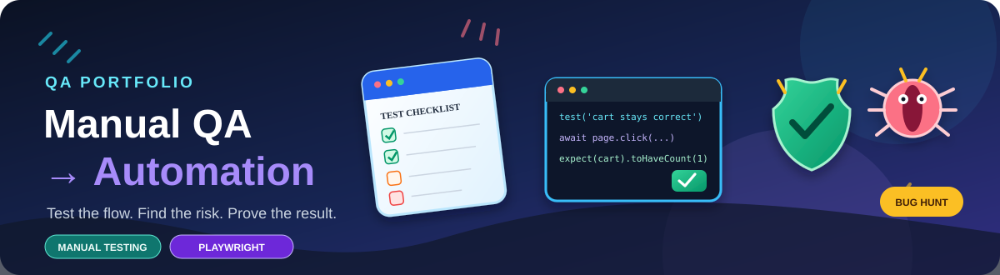

<div align="center">
  
</div>

<div align="center">

[](https://www.python.org/)
[](https://playwright.dev/python/)
[](#demoqa-elements-manual-testing)
[](https://github.com/OperaAxe/Manual---Automation-Portfolio/actions/workflows/playbook-tests.yml)

</div>

# Manual QA → Automation

This is my main QA portfolio repository. It brings together manual testing work, bug reports, and small Playwright checks in one place.

The point is to show how a test starts with a question about product behaviour, how the result is documented, and where automation can make the check repeatable.

## What's inside

| Area | What you'll find |
|---|---|
| **DemoQA manual testing** | Excel test pack for the [Elements section](https://demoqa.com/elements), with 30 scenarios and a defect log |
| **Test planning** | Scope, approach, test data, and current limitations |
| **Bug reporting** | Reproduction steps, expected vs actual results, severity, evidence notes, and triage state |
| **Playwright automation** | Runnable tests for a small local storefront included in this repo |
| **CI** | GitHub Actions runs the local storefront suite on pushes and pull requests |

## DemoQA Elements manual testing

**Target:** [demoqa.com/elements](https://demoqa.com/elements)  
**Initial test pass:** 27 October 2026

[**Open the Excel test pack**](manual-testing/DemoQA_Elements_Manual_Testing.xlsx) · [Test plan](docs/demoqa-elements-test-plan.md) · [Bug report template](docs/bug-report-template.md)

The workbook has a summary dashboard, 30 manual test scenarios, and a defect log.

| Result | Count |
|---|---:|
| Scenarios written | 30 |
| Passed in the observed session | 17 |
| Failed observations | 7 |
| Not run yet | 6 |

The seven logged observations cover visible copy problems, email-validation feedback, and DOM-level accessibility risks. Some accessibility items still need checking with the browser accessibility tree and assistive technology before they should be treated as fully confirmed.

**Thirty test cases do not mean thirty bugs.** The workbook keeps unrun tests separate from failures, and it does not count browser-tool timeouts as product defects. DemoQA is a public practice site; its deliberately broken image example is expected test data, not a defect in the site.

## Playwright practice project

The automation suite currently targets the **local storefront in `demo/storefront.html`**, not DemoQA. Keeping the target local makes these checks repeatable without relying on a third-party site being online.

Current checks cover product rendering, cart totals, quantity changes, removing an item without removing another item, and checkout-form behavior. It is a learning project, not a real store: it takes no payments and creates no real orders.

### Run it locally

Requires Python 3.11 or newer.

```bash
python -m venv .venv
```

Activate the environment:

```bash
# macOS / Linux
source .venv/bin/activate

# Windows PowerShell
.venv\Scripts\Activate.ps1
```

Install dependencies and run the tests:

```bash
python -m pip install -r requirements.txt
python -m playwright install chromium
pytest -v
```

Run the small smoke check on the local storefront:

```bash
python first_test.py
```

## How I approach a test

- Decide what behaviour matters before clicking around.
- Use realistic but safe test data.
- Check the resulting state, not just whether a button responded.
- Read data back after a rejected or destructive action when a side effect is possible.
- Write the exact steps and evidence another person would need to reproduce an issue.
- Treat an unexplained failure as something to investigate, not automatic proof of a product bug.

## Repository map

```text
.
├── assets/
│   └── qa-stickers.svg
├── demo/
│   └── storefront.html
├── docs/
│   ├── bug-report-template.md
│   └── demoqa-elements-test-plan.md
├── manual-testing/
│   ├── README.md
│   └── DemoQA_Elements_Manual_Testing.xlsx
├── tests/
│   └── test_storefront.py
├── first_test.py
├── pytest.ini
└── requirements.txt
```

## Current limits

The DemoQA pack is an initial pass, not a full audit. Six scenarios still need execution, and several accessibility observations need a second check. The Playwright suite covers the local fixture only. Test results will change as coverage grows, and the repository will be updated as new checks and evidence are added.

---

<div align="center">
  <strong>Good testing makes the next decision easier.</strong><br/>
  Christian David · QA Engineering · Manual Testing → Automation
</div>
